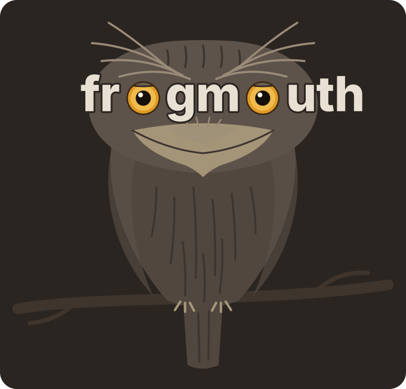

<h1 align="center">
  
</h1>

<p align="center">Sticky notes and secrets in one file on your disk.<br>One HTML page, no server, no network, no accounts.</p>

The tawny frogmouth is a nocturnal bird that hides in plain sight by posing as a broken branch. Its two amber eyes are the two o's in the name, and they follow your cursor.

## Use it

1. Download `frogmouth.html` and open it in Chrome, Edge, Brave or Arc. Opening it straight from disk (`file://`) works.
2. Click **Open a folder** and pick (or create) a folder for your vault.
3. frogmouth creates `vault.frogmouth` in that folder and saves to it as you type.

Firefox and Safari cannot write to folders on disk. There you can use **Try it without saving** and **Import a .frogmouth file**, and download the vault with `⌘S`.

## What it does

**Boards of sticky notes**
- The notes get the whole window. Only a few controls float over it: the logo (its menu holds theme, encryption and shortcuts), a three-way switch (board, all notes, secrets), the board pills, search, and the sync icon.
- Boards are floating pills. Click one to open it, double-click to rename it in place, drag to reorder, hover for × to delete (undoable). **+** adds a board. `⌥1`–`⌥9` and `⌘K` then `#` work too.
- Click a note to select it and drag it from anywhere to move it. Double-click (or `↵`) to edit, with the caret where you clicked. `Esc` stops editing.
- Resize from the right edge, bottom edge or corner (double-click the bottom edge for automatic height). Pick from six paper colours.
- Pan with the wheel, space-drag or a drag on empty board. Zoom with `⌘`+wheel or a pinch.
- **Arrange notes** tidies a board into columns. **Fit** shows everything at once.
- The first line of a note is its title. Nothing else is needed.

**The editor**
- `/` opens the block menu: headings, lists, todos, code, quote, divider, image, file tag, note link, secret reference and date.
- Markdown shortcuts: `# `, `## `, `- `, `1. `, `[] `, `> `, `---`, ```` ```lang ````, and `` `inline code` ``.
- `@` links another note **or tags any file in the vault folder**, such as `diagram.excalidraw`. Clicking a note link jumps to that note. Clicking a file tag opens the file, saves a copy, or copies its path.
- Notes that link to a note are listed at its foot ("2 notes link here").
- Code blocks are syntax-highlighted as you type: JS/TS, Python, Go, Rust, C-family, shell, SQL, JSON, YAML, CSS, HTML, Ruby, PHP and diff. They auto-indent, take `Tab`, and have their own undo. The language label is a menu.
- Images: paste, drop or `/image`. Pasted images are saved into `assets/` in the vault. **Each image zooms (wheel) and pans (drag) inside its own frame**, separate from the board. Double-click an image to fit it, and drag its bottom edge to change its height.
- Dropping any other file copies it into `files/` and tags it in the note.

**Tags on notes**
- Notes take the same tags as secrets: plain (`api`) and key:value (`env:prod`).
- On the board they show at the foot of each note. Add them with **+ tag** or `T` on a selected note; names autocomplete from every tag in the vault.
- Click a tag on a note to see every note with that tag.

**All notes page** (the middle icon, `⌥L`)
- Every note on every board in one sortable table: title and preview, board, tags, links, last updated. Click a column header to sort; click again to reverse.
- Filter with text, board names and tags, e.g. `deploy env:prod -draft`, or click a tag chip.
- `→ 2` / `← 1` show the notes a note links to and the notes linking to it; click for the list.
- Click a row (or `↵`) to jump to the note on its board, or click the board name to open the board.

**Secrets**
- Key/value pairs with plain tags (`aws`) and key:value tags (`env:prod`). Every tag is listed as a chip under the filter; click one to filter by it.
- Filter syntax: `env:prod aws -legacy`.
- Values stay masked until you reveal them. Search never looks at values.
- `c` copies the value, `⇧C` copies the key, and Enter in the filter copies the top match.
- Import a pasted `.env` file. Copy the listed secrets back out as `.env`.
- Generate random values.

**Search everything** with `⌘K`. Prefixes: `>` commands, `@` notes, `$` secrets, `#` boards.

**Sync icon** (top right):
- A file with a tick: everything is saved to the vault file.
- A file with a dot: unsaved changes, saving shortly.
- A file with `!`: the save failed (click to retry), or the file changed on disk (click to choose a version).
- A struck-out file: nothing is written to any file (the in-tab mode). Click to download the vault.
- A small lock on the icon means the vault is encrypted.
- The vault file is watched. If another window, a sync tool or `git pull` changes it, frogmouth reloads it.
- If you also have unsaved edits, it asks which version to keep.

**Encryption** (optional): choose **Encrypt with a passphrase** in the board menu (or `⌘⇧P`).
- The vault file becomes AES-256-GCM with a PBKDF2-SHA256 key (600k iterations).
- The vault locks after 15 minutes idle or on `⌘⇧L`.
- Images and tagged files in the folder are **not** encrypted.
- There is no recovery for a forgotten passphrase.

**Backups**: once a day, the vault file is copied to `.frogmouth-backups/`. The last 14 copies are kept.

## Keyboard

Press `?` in the app for the full list.

| Everywhere | |
|---|---|
| `⌘K` / `⌘P` | Search |
| `⌘⇧P` | Commands |
| `⌘S` | Save now |
| `⌥B` `⌥L` `⌥S` | Board, all notes, secrets |
| `⌥1`–`⌥9`, `⌥[` `⌥]` | Switch boards |
| `⌘Z` | Undo a delete |

| Board | |
|---|---|
| `N` or double-click | New note |
| `Tab` | Next note |
| click, drag | Select, move |
| double-click, `↵` / `Esc` | Edit / stop editing |
| arrows | Nudge |
| `1`–`6` | Colour |
| `⌘D` | Duplicate |
| `T` | Tag the note |
| `Del` | Delete |
| `=` `-` `0` `⇧1` | Zoom in, out, 100%, fit |

| Secrets | |
|---|---|
| `j` `k` | Move |
| `c` | Copy value |
| `⇧C` | Copy key |
| `Space` | Reveal |
| `↵` | Edit |
| `N` | New |
| `/` | Filter |
| `Del` | Delete |

## The vault folder

```
my-vault/
  vault.frogmouth        # all boards, notes and secrets (JSON, or encrypted JSON)
  assets/                # images pasted or dropped into notes
  files/                 # other files dropped into notes
  .frogmouth-backups/    # daily copies of vault.frogmouth
  anything-else.excalidraw   # any file here can be tagged with @
```

Unencrypted, `vault.frogmouth` is pretty-printed JSON, so it diffs well in git:

```json
{"frogmouth":1,"encrypted":false,"saved":"…","data":{
 "boards":[{"id":"…","name":"Inbox","notes":[{"id":"…","x":80,"y":80,"w":300,"color":"straw","html":"<p>Title</p>…"}]}],
 "secrets":[{"id":"…","key":"DATABASE_URL","value":"…","tags":["env:prod","db"],"desc":""}],
 "ui":{"board":"…","active":"b:…"}}}
```

## Privacy and security

- A Content-Security-Policy in the page forbids every network request (`connect-src 'none'`, no external scripts, styles, fonts or images). Nothing leaves your machine.
- Note HTML is sanitized on load and paste. Scripts, event handlers, `javascript:` links, remote images and paths with `..` are removed.
- In a plain vault, secrets are only as safe as the folder they sit in. Use a passphrase if the folder syncs anywhere.

## Development

No dependencies: plain JavaScript and CSS, inlined into one file (fonts included, as base64) by a stdlib Python script.

```sh
python3 build.py          # -> frogmouth.html
python3 test/run.py       # builds test/frogmouth.test.html and runs the smoke suite in headless Chrome
```

```
src/index.html        page shell + CSP
src/css/00-fonts.css  embedded JetBrains Mono (@font-face)
src/css/app.css       all styles (night and day themes)
src/fonts/            JetBrains Mono woff2 files + OFL license, inlined by build.py
src/js/00-util.js     helpers, fuzzy matching, toasts, IndexedDB
src/js/01-bird.js     the frogmouth: wordmark, eye tracking, blinking, lids
src/js/02-crypto.js   optional AES-GCM vault encryption
src/js/03-store.js    state, the .frogmouth file, autosave, disk watching, images, files
src/js/04-highlight.js  syntax highlighter
src/js/05-ui.js       popup menus and modals
src/js/06-editor.js   note editor: / menu, @ tags, markdown shortcuts, code blocks, images
src/js/07-board.js    canvas: notes, drag, resize, pan, zoom, arrange
src/js/08-secrets.js  secrets list, .env import/export
src/js/08b-notes.js   all-notes page: sort, filter, tags, links
src/js/09-palette.js  search and commands
src/js/10-app.js      shell: welcome, floating controls, board menu, sync icon, keyboard
test/smoke.js         smoke tests (UI typing, sanitizer, crypto, real file writes via OPFS)
```

The JS files are concatenated in name order into one scope, so later files can use earlier ones.

## License

MIT for frogmouth itself.

The page embeds [JetBrains Mono](https://github.com/JetBrains/JetBrainsMono), licensed under the SIL Open Font License 1.1 (`src/fonts/OFL.txt`).
