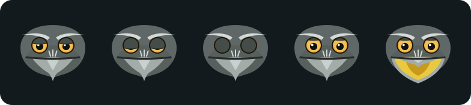

# frogmouth brand



The symbol is a tawny frogmouth seen head on. Tawny frogmouths are often mistaken for owls, so the drawing leans on what is only theirs: a broad, flat head with no ear tufts, pale brow stripes, a gape almost as wide as the face, a horn-coloured hooked beak with a bristle tuft, and heavy lids over orange-red eyes, the colour many frogmouths' eyes glow.

Character: calm and watchful, never cross. The **brows** carry the sharp lines; the **lids** are level and droop gently, so the bird looks sleepy-wise rather than angry. The wordmark is set in JetBrains Mono ExtraBold, the app's typeface, and its two o's are the same eyes.

## The logo system

Use the largest level that fits. Smaller levels are redrawn for their size, not shrunk.

| Level | File | Use | Minimum |
|---|---|---|---|
| Full | `frogmouth-stacked-on-dark.svg`, `-on-light.svg` | Symbol above wordmark. Splash screens, README, square or centred layouts. | 96 px tall |
| Primary | `frogmouth-lockup-on-dark.svg`, `-on-light.svg` | Symbol beside wordmark, the wordmark centred on the head. The default logo. | 160 px wide |
| Compact | `frogmouth-wordmark-on-dark.svg`, `-on-light.svg` | Wordmark alone, where the symbol already appears nearby. | 96 px wide |
| Icon | `frogmouth-mark.svg` | The symbol alone: avatars, app UI, social. Works on dark and light. | 33 px |
| Small icon | `frogmouth-mark-small.svg` | Redrawn for 16 to 32 px (no throat shading, ridge or bristles; bigger eyes, heavier mouth line). The favicon. | 16 px |
| App icon | `frogmouth-app-icon.svg` | The symbol on a slate rounded square, 512 × 512. | 32 px |

One colour, for print, embossing, stamps and anywhere full colour is not possible: `frogmouth-mark-mono-ink.svg` on light backgrounds, `frogmouth-mark-mono-white.svg` (reversed) on dark ones. Full colour is always preferred.

## Clear space

The unit is one eye: the diameter of an eye in the symbol (26 / 128 of its width), or of an eye-o in the wordmark. Keep at least one unit clear on every side of every level. Nothing else (text, edges, other logos) goes inside it.

## Expressions

A mascot is a set of faces, not one. The app shows them live; `frogmouth-expressions.svg` has them side by side.

| Expression | When |
|---|---|
| Rest | Default. Heavy, level lids; the eyes follow the pointer or text caret. |
| Squint | After 30 seconds idle, the way a frogmouth narrows its eyes to stay hidden. Sleepier still after two minutes. |
| Eyes closed | While a secret value is being typed. |
| Wide | On search, and when startled. |
| Gape | Click the bird: eyes wide, the upper beak folds up and a wide yellow mouth opens below it, the frogmouth's real threat display. |

## Colours

| | Hex | Where |
|---|---|---|
| Iris | `#E8662E` | The bird's eyes (brand only; the app's UI accent is chosen separately, see below) |
| Plumage | `#5F6866` | The head |
| Lid | `#454D4B` | Eyelids |
| Brow | `#D3D9D6` | Brow stripes, bristles |
| Horn | `#B8AE90` | The beak |
| Mouth | `#E9C93F` | Inside the gape (only when open) |
| Night slate | `#121A1D` | Dark background |
| Leaf grey | `#DCE6E3` | Wordmark on dark |
| Ink | `#17232A` | Wordmark on light, one-colour symbol |
| Eucalyptus mist | `#EDF2F0` | Light background |

## The app's UI colours

The interface is deliberately calm: neutral charcoal (`#1D1E21`) or light grey (`#F4F4F3`) surfaces with no tint, softened text, quiet note colours, and one muted accent the user picks from the logo menu:

| Accent | Dark theme | Light theme |
|---|---|---|
| Orange (default) | `#D97757` | `#C8623F` |
| Green | `#7FAE86` | `#3F7D4E` |
| Purple | `#A493E6` | `#6C58C9` |

The bird keeps its orange-red eyes in every accent; they are the brand, not the UI.

## Do not

- Angle the lids toward the beak (it reads as anger) or add ear tufts (it reads as an owl).
- Recolour the bird, stretch it, rotate it, or add outlines, shadows or gradients.
- Swap the eye-o's for plain o's, or set the wordmark in another typeface.
- Use the full-colour symbol below 33 px; use the small icon.
- Put the logo on busy images or low-contrast backgrounds.

## Construction and editing

The symbol is drawn on a 128-unit grid with a 2-unit base; eyes are 13 units in radius, centred 44 units apart, level with the wordmark's eye-o's in the primary lockup. Its shapes and colours live once in `src/brand/mark.json`, which the app draws its live bird from. Layers flagged `detail` are dropped for the small icon; `jaw` and `mouth` layers make the gape.

After changing it, regenerate everything here and the favicon:

```sh
pip install fonttools brotli
python3 tools/brand.py
npm run build
```
